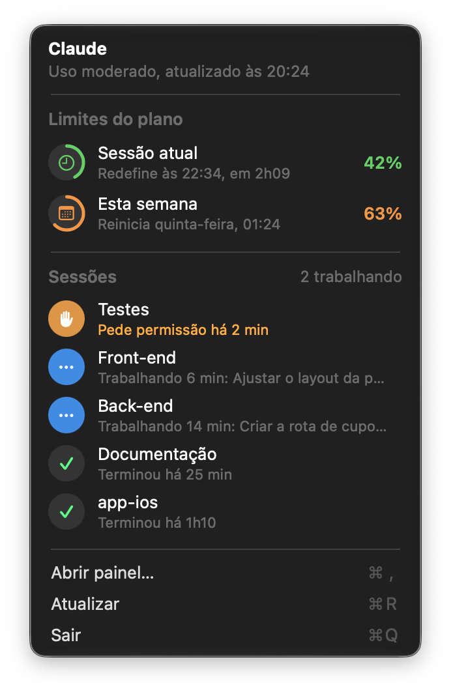
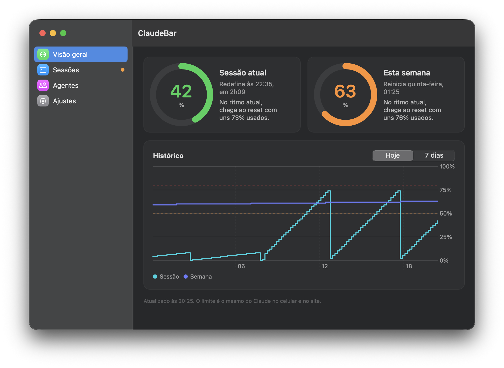
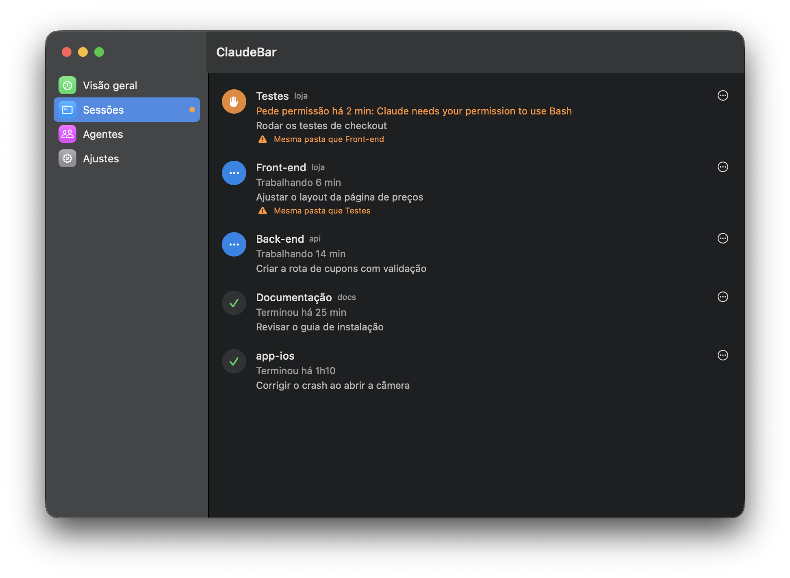
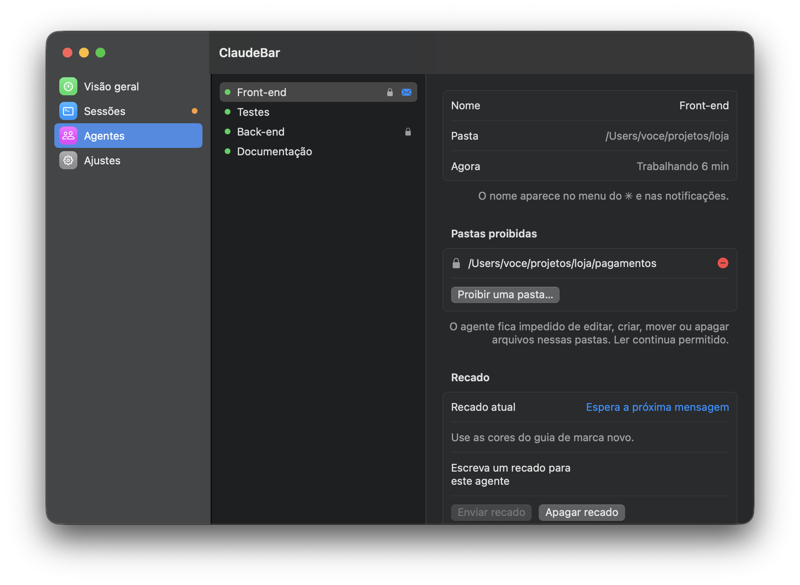
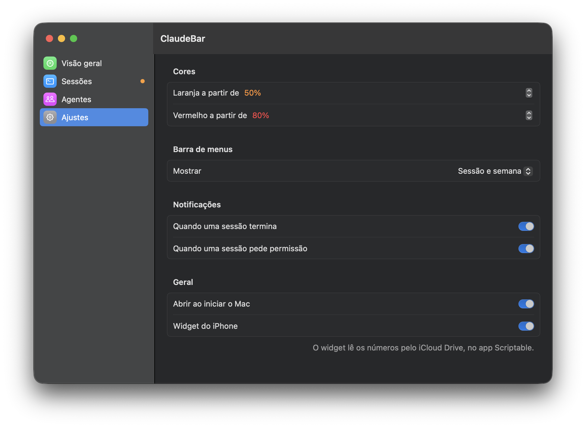

# ClaudeBar

**English** · [Português](README.pt-BR.md)

A macOS menu bar app that shows your Claude plan usage (the 5-hour session and the weekly limit) without opening Claude, and keeps track of the Claude Code sessions running on your Mac.

<p align="center">
  
  
</p>

- **Menu bar:** ✳ with the session and weekly percentages in green, orange or red. It blinks when a terminal is waiting for permission.
- **Menu:** plan limits with their reset times, and your sessions (working, waiting for permission, done).
- **Panel** (open the app, or ⌘, from the menu):
  - Overview with a usage chart and a forecast of when you'll hit the limit.
  - Open sessions, with a warning when two terminals work in the same folder.
  - Agents: name each terminal, lock folders it can't change (enforced by a hook), and leave a note it receives with your next message.
  - Settings: colors, what the menu bar shows, notifications, launch at login.
- **Notifications** when a session finishes or asks for permission.
- **iPhone widget** through [Scriptable](https://scriptable.app), reading a file the Mac writes to iCloud Drive.

<p align="center">
  
  
  
</p>

The interface is in Brazilian Portuguese for now; translations are welcome. Screenshots use demo mode (sample data); regenerate them with `./tools/screenshots.sh`.

Lightweight: it checks usage every 2 minutes, never reads Claude Code's transcripts, and builds the menu only when you open it.

## Requirements

- macOS 13 or later (Apple Silicon or Intel)
- Claude Code signed in with a Pro or Max account (the app reads the login Claude Code keeps in the Keychain)
- Xcode Command Line Tools (`xcode-select --install`) and `jq` (`brew install jq`)

## Install

```bash
git clone https://github.com/diegoferrera/claudebar.git
cd claudebar
./install.sh
```

`install.sh` builds the app, makes it launch at login, and adds the ClaudeBar hooks to `~/.claude/settings.local.json`. It backs the file up to `settings.local.json.bak-claudebar` first and keeps any hooks you already have.

After changing the code, rebuild with `./build.sh`.

### iPhone widget

1. Turn on iCloud Drive on the Mac and install Scriptable on the iPhone.
2. With ClaudeBar running, `Claude.js` shows up in the Scriptable folder.
3. On the iPhone, add a Scriptable widget and pick the **Claude** script.

## How it works

- Usage comes from `api.anthropic.com/api/oauth/usage` (undocumented; it's what the "Usage" screen uses), with Claude Code's token from the Keychain. If the API rate-limits (429), the app backs off and keeps showing the last value.
- `session.sh` runs from Claude Code hooks and writes each session's state to `~/.claude/menubar/sessions/`.
- On `PreToolUse`, `session.sh guard` denies edits inside an agent's locked folders.
- Terminals are recognized by their Maestri terminal id when there is one, otherwise by folder.

## Layout

```
src/Core.swift        data: usage, sessions, history, agents, settings, widget
src/MenuViews.swift   menu bar dropdown
src/PanelViews.swift  panel window
src/main.swift        app, timers, status item
src/Demo.swift        sample data for demo mode
session.sh            Claude Code hooks
widget.js             Scriptable widget
tools/icon.swift      draws the app icon
tools/screenshots.sh  regenerates docs/ screenshots (demo mode)
resources/            Info.plist and app icon
```

## Contributing

See [CONTRIBUTING.md](CONTRIBUTING.md) (in Portuguese; issues and pull requests in English are welcome too). [MIT](LICENSE) licensed.

> Independent project, not affiliated with Anthropic. It relies on an undocumented endpoint that may change at any time.
